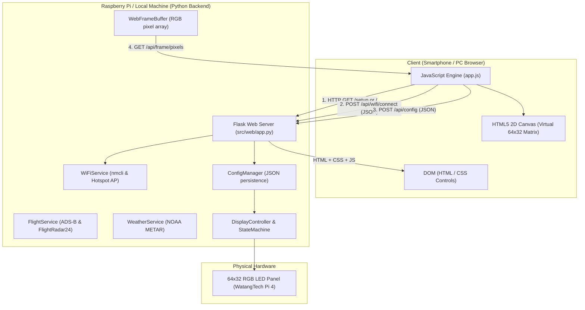
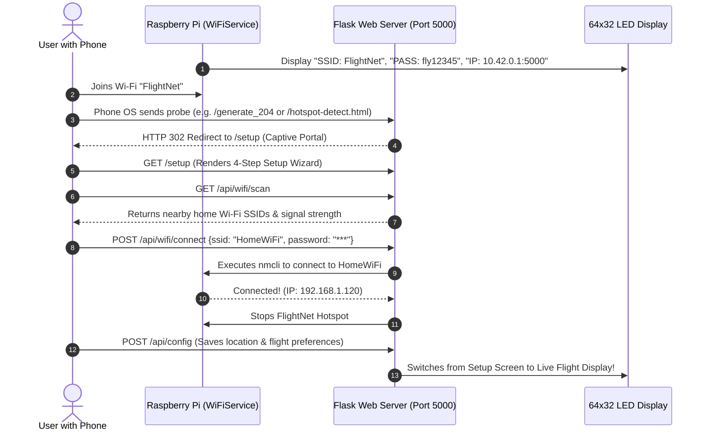

# Web Portal Architecture & Developer Guide

This document explains the architecture, design patterns, and core mechanisms of the **LED Flight Information Display Web Portal**. It is tailored for developers who have general programming experience (e.g., Python, C++, embedded systems) but are new to modern web development.

---

## 1. High-Level Mental Model for Programmers

If you are accustomed to desktop software or embedded programming, web development can be understood through this mental model:

```
[ Embedded / Desktop Program ]         [ Web Application Architecture ]
Main Memory / Objects           <--->  Server State & Database (Python Backend)
Function Call with Arguments    <--->  HTTP Request (GET / POST with JSON body)
Function Return Value           <--->  HTTP Response (HTML or JSON payload)
User Interface Window (Qt/GUI)  <--->  Browser Document Object Model (DOM: HTML/CSS)
Event Loop (e.g. while running) <--->  Browser JavaScript Event Loop & Fetch Polling
```

In our system, the **Raspberry Pi** acts as the **Server**, and any **Smartphone or Computer** browsing the setup page acts as the **Client**.

### The Three Pillars of the Web
1. **HTML (Structure)**: Defines the page skeleton (forms, buttons, inputs, canvas). In our project, these are Jinja2 templates: [`index.html`](file:///Volumes/ssd/Documents/github/led_flight_info/src/web/templates/index.html) and [`setup.html`](file:///Volumes/ssd/Documents/github/led_flight_info/src/web/templates/setup.html).
2. **CSS (Styling)**: Controls visuals, layout, colors, dark mode, and responsiveness: [`style.css`](file:///Volumes/ssd/Documents/github/led_flight_info/src/web/static/css/style.css).
3. **JavaScript (Behavior & Interactivity)**: Runs inside the user's browser, handles button clicks, talks to the Python backend asynchronously, and renders the virtual LED matrix canvas: [`app.js`](file:///Volumes/ssd/Documents/github/led_flight_info/src/web/static/js/app.js).

---

## 2. End-to-End System Architecture



---

## 3. Wi-Fi Access Point (Hotspot) & Captive Portal Flow

When the device is powered on for the first time, it has no saved home Wi-Fi credentials. It boots into **Standalone AP Hotspot Mode**:



---

## 4. Backend Architecture: Python & Flask

The backend lives in [`src/web/app.py`](file:///Volumes/ssd/Documents/github/led_flight_info/src/web/app.py). It uses **Flask**, a lightweight Python WSGI (Web Server Gateway Interface) microframework.

### 4.1 The Application Factory Pattern
Instead of declaring a global `app = Flask(__name__)`, we use an application factory function [`create_app()`](file:///Volumes/ssd/Documents/github/led_flight_info/src/web/app.py#L22-L38):

```python
def create_app(
    config: ConfigManager,
    controller: DisplayController,
    flight_service: FlightService,
    weather_service: WeatherService,
    wifi_service: WiFiService,
) -> Flask:
    app = Flask(__name__, template_folder=..., static_folder=...)
    ...
    return app
```
**Why do this?**
- **Dependency Injection**: The web server needs to inspect the current display state, trigger flights, query Wi-Fi, and change configuration. Passing these service instances directly into `create_app` avoids messy global variables and makes testing clean with `pytest`.

### 4.2 Page Routes vs. REST API Routes
Flask uses Python decorators (`@app.route(...)`) to bind URL paths to Python functions:

#### 1. Page Routes (HTML Templating)
When the browser requests an HTML page:
```python
@app.route("/")
def index():
    return render_template("index.html", config=config.to_dict(), is_setup=config.is_setup_completed)

@app.route("/setup")
def setup():
    return render_template("setup.html", config=config.to_dict(), hotspot=wifi_service.get_hotspot_info())
```
- `render_template` uses **Jinja2** to inject Python variables directly into HTML before sending it across the network (e.g. `{{ config.location.lat }}`).

#### 2. Captive Portal Probe Interception
Smartphones automatically send HTTP probes when joining a Wi-Fi hotspot without internet:
- iOS / Apple: `/hotspot-detect.html`
- Android / Chrome: `/generate_204`, `/gen_204`
- Windows: `/ncsi.txt`, `/connecttest.txt`

In [`app.py`](file:///Volumes/ssd/Documents/github/led_flight_info/src/web/app.py#L53-L62):
```python
@app.route("/hotspot-detect.html")
@app.route("/generate_204")
@app.route("/gen_204")
@app.route("/ncsi.txt")
@app.route("/connecttest.txt")
def captive_portal_probe():
    return redirect("/setup")
```
When the phone probes these URLs, Flask returns an HTTP 302 redirect to `/setup`, prompting the phone OS to immediately pop up the setup wizard on the user's screen.

#### 3. REST API Routes (JSON Data Exchange)
Modern web pages don't reload the entire screen when a setting changes. Instead, JavaScript sends lightweight JSON payloads via REST endpoints:

- `GET /api/status`: Returns current screen mode, tracked flight info, weather, and brightness.
- `POST /api/config`: Receives configuration JSON, parses it via `request.get_json()`, updates [`ConfigManager`](file:///Volumes/ssd/Documents/github/led_flight_info/src/config.py), and writes to disk.
- `GET /api/wifi/scan`: Triggers [`WiFiService.scan_wifi()`](file:///Volumes/ssd/Documents/github/led_flight_info/src/services/wifi_service.py#L182) which invokes `nmcli` on the Pi to search for SSIDs.
- `POST /api/wifi/connect`: Receives `{ssid, password}`, connects the Pi to home Wi-Fi, and shuts down the temporary hotspot.
- `GET /api/frame/pixels`: Returns a $32 \times 64$ nested list of `[R, G, B]` integers representing the exact diodes lit on the matrix.

---

## 5. Frontend Architecture: HTML, CSS & JavaScript

The frontend lives in:
- HTML Templates: [`src/web/templates/index.html`](file:///Volumes/ssd/Documents/github/led_flight_info/src/web/templates/index.html) and [`src/web/templates/setup.html`](file:///Volumes/ssd/Documents/github/led_flight_info/src/web/templates/setup.html)
- JavaScript Engine: [`src/web/static/js/app.js`](file:///Volumes/ssd/Documents/github/led_flight_info/src/web/static/js/app.js)
- CSS Styles: [`src/web/static/css/style.css`](file:///Volumes/ssd/Documents/github/led_flight_info/src/web/static/css/style.css)

### 5.1 Asynchronous Communication (`fetch` and `async/await`)
In browser JavaScript, all network operations are non-blocking so the browser UI never freezes while waiting for a response. We use the modern `fetch()` API with `async/await`:

```javascript
// Example: Scanning for Wi-Fi in setup.html
async function loadWifiList() {
  try {
    // 1. Send HTTP GET to Python backend
    const res = await fetch("/api/wifi/scan");
    // 2. Parse response JSON
    const data = await res.json();
    // 3. Dynamically generate HTML elements in the page
    data.networks.forEach(net => {
      const item = document.createElement("div");
      item.className = "wifi-item";
      item.textContent = `${net.ssid} (${net.signal}%)`;
      container.appendChild(item);
    });
  } catch (err) {
    console.error("Scan failed", err);
  }
}
```

### 5.2 Emulating Physical LED Matrix with HTML5 Canvas
One of the key features of the web portal is the **Live Virtual LED Matrix**. Instead of a static image, the browser renders individual circular LED diodes with realistic lens physics and light blooming:

In [`app.js`](file:///Volumes/ssd/Documents/github/led_flight_info/src/web/static/js/app.js#L47-L83):
```javascript
function renderPixelMatrix(pixels) {
  // 1. Clear bezel background to dark cockpit gray
  ctx.fillStyle = "#0c0d11";
  ctx.fillRect(0, 0, canvas.width, canvas.height);

  // 2. Iterate through 32 rows and 64 columns (2048 diodes)
  for (let y = 0; y < MATRIX_HEIGHT; y++) {
    for (let x = 0; x < MATRIX_WIDTH; x++) {
      const rgb = pixels[y][x]; // [R, G, B]
      const cx = x * LED_PITCH + LED_PITCH / 2;
      const cy = y * LED_PITCH + LED_PITCH / 2;

      ctx.beginPath();
      ctx.arc(cx, cy, LED_RADIUS, 0, Math.PI * 2);

      if (rgb[0] > 0 || rgb[1] > 0 || rgb[2] > 0) {
        // Active LED: Draw glow shadow + colored diode
        ctx.fillStyle = `rgb(${rgb[0]}, ${rgb[1]}, ${rgb[2]})`;
        ctx.shadowColor = `rgba(${rgb[0]}, ${rgb[1]}, ${rgb[2]}, 0.5)`;
        ctx.shadowBlur = 4;
        ctx.fill();

        // Diode Glint: Off-center white specular reflection
        ctx.beginPath();
        ctx.arc(cx - 1, cy - 1, LED_RADIUS * 0.35, 0, Math.PI * 2);
        ctx.fillStyle = "rgba(255, 255, 255, 0.4)";
        ctx.fill();
      } else {
        // Unlit LED: Dark unpowered diode pellet
        ctx.fillStyle = "#16171f";
        ctx.shadowBlur = 0;
        ctx.fill();
      }
    }
  }
}
```

### 5.3 Frame Polling Loop
To keep the browser canvas synchronized with the matrix display at ~7 frames per second, [`startFramePolling()`](file:///Volumes/ssd/Documents/github/led_flight_info/src/web/static/js/app.js#L31-L45) uses a recursive `setTimeout` loop:
```javascript
function startFramePolling() {
  const poll = async () => {
    try {
      const res = await fetch("/api/frame/pixels");
      if (res.ok) {
        const data = await res.json();
        renderPixelMatrix(data.pixels);
      }
    } catch (e) {
      // Server rebooting or temporary network disconnect
    }
    // Schedule next poll in 150 milliseconds
    pollTimer = setTimeout(poll, 150);
  };
  poll();
}
```

---

## 6. Key Functions Reference

### Backend Methods

| Module | Method | Description |
| :--- | :--- | :--- |
| [`app.py`](file:///Volumes/ssd/Documents/github/led_flight_info/src/web/app.py) | `create_app()` | Application factory that mounts templates, static files, and routes. |
| [`app.py`](file:///Volumes/ssd/Documents/github/led_flight_info/src/web/app.py#L91-L115) | `update_config()` | Handles `POST /api/config`, validates JSON, and updates user preferences. |
| [`app.py`](file:///Volumes/ssd/Documents/github/led_flight_info/src/web/app.py#L124-L134) | `get_frame_pixels()` | Serializes the active RGB canvas buffer into JSON for canvas rendering. |
| [`wifi_service.py`](file:///Volumes/ssd/Documents/github/led_flight_info/src/services/wifi_service.py#L61-L125) | `start_hotspot()` | Creates and activates NetworkManager Wi-Fi AP (`FlightNet`, `10.42.0.1`). |
| [`wifi_service.py`](file:///Volumes/ssd/Documents/github/led_flight_info/src/services/wifi_service.py#L182-L208) | `scan_wifi()` | Runs `nmcli dev wifi list --rescan yes` on Pi to find nearby networks. |
| [`wifi_service.py`](file:///Volumes/ssd/Documents/github/led_flight_info/src/services/wifi_service.py#L210-L232) | `connect_wifi()` | Connects Pi to home Wi-Fi via `nmcli` and tears down setup hotspot. |

### Frontend Functions

| File | Function | Description |
| :--- | :--- | :--- |
| [`app.js`](file:///Volumes/ssd/Documents/github/led_flight_info/src/web/static/js/app.js#L18-L29) | `initCanvas()` | Initializes the HTML5 2D canvas context and pixel dimensions. |
| [`app.js`](file:///Volumes/ssd/Documents/github/led_flight_info/src/web/static/js/app.js#L47-L83) | `renderPixelMatrix()` | Renders 2048 LED diodes with circular glow and specular lens glints. |
| [`app.js`](file:///Volumes/ssd/Documents/github/led_flight_info/src/web/static/js/app.js#L175-L227) | `saveConfig()` | Serializes form fields into JSON and sends `POST /api/config`. |
| [`setup.html`](file:///Volumes/ssd/Documents/github/led_flight_info/src/web/templates/setup.html#L211-L245) | `loadWifiList()` | Calls `/api/wifi/scan` and dynamically renders selectable Wi-Fi network cards. |
| [`setup.html`](file:///Volumes/ssd/Documents/github/led_flight_info/src/web/templates/setup.html#L247-L280) | `btnConnectWifi` listener | Submits SSID and password to `/api/wifi/connect` and reports status. |
| [`setup.html`](file:///Volumes/ssd/Documents/github/led_flight_info/src/web/templates/setup.html#L282-L300) | `btnPhoneGps` listener | Uses W3C Geolocation API (`navigator.geolocation`) to get phone GPS. |

---

## 7. Programmer's Web Development Cheat Sheet

If you come from C/C++/Python systems programming, keep this cheat sheet handy:

| Concept | Traditional Software Equivalent | Web Portal Implementation |
| :--- | :--- | :--- |
| **Data Format** | C Struct / Python Dict | **JSON** (`{"ssid": "FlightNet", "signal": 95}`) |
| **API Invocation** | Remote Procedure Call (RPC) | **HTTP REST API** (`GET`, `POST` with headers & body) |
| **Status Codes** | Error codes (`0`, `-1`, `EINVAL`) | **HTTP Status Codes** (`200 OK`, `302 Redirect`, `400 Bad Request`, `500 Error`) |
| **GUI Framework** | Qt, GTK, wxWidgets | **HTML DOM Elements** (`<div>`, `<input>`, `<button>`) |
| **Graphics Rendering** | OpenGL / SDL / Framebuffer | **HTML5 `<canvas>`** 2D Context (`ctx.arc()`, `ctx.fill()`) |
| **Asynchronous Task** | Background Thread / Future | **JavaScript `Promise`** with `async / await` |
| **Timer / Interrupt** | Timer Interrupt / `sleep()` | **`setTimeout(fn, ms)`** (Non-blocking browser timer) |

---

## 8. Testing & Development Tips

### Running the Web Portal Locally
You don't need a Raspberry Pi to experiment with the web portal. Run:
```bash
python run.py --web-only
```
- Open your browser to **[http://localhost:5000](http://localhost:5000)**.
- To test the first-time onboarding wizard, open **[http://localhost:5000/setup](http://localhost:5000/setup)** or pass `--reset-setup`:
  ```bash
  python run.py --web-only --reset-setup
  ```
- Any edits to HTML, CSS, or JS take effect on browser refresh. Edits to Python automatically apply on restarting the server.
